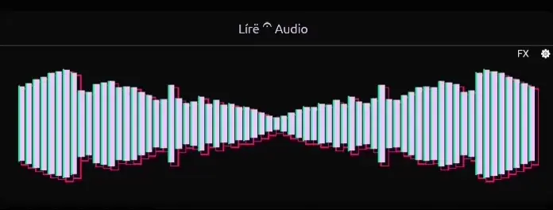
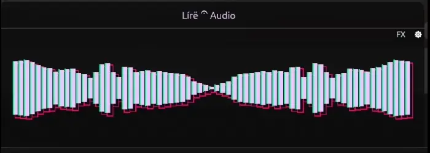
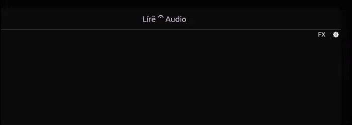

<h1 align="center"> Lírë 𝄐 Audio </h1>
<h3 align="center">
<details>
    <summary>Showcases</summary>
<br>

<!-- <a style="font-size: 16px;" href="https://www.youtube.com/watch?v=hhJdu1v4tfU&list=RDhhJdu1v4tfU&start_radio=1" target="_blank">First music link</a> -->



<!-- <a style="font-size: 16px;" href="https://www.youtube.com/watch?v=wko2BMFyVF8" target="_blank">Second music link</a> -->



<!-- <a style="font-size: 16px;" herf="https://www.youtube.com/watch?v=_P7S2lKif-A&list=RD_P7S2lKif-A&start_radio=1" target="_blank">Third music link</a> -->



<p style="font-size: 12px;">These showcases are illustrative, the colors don't match with the actual app. Can't make Obs get the real colors.</p>
</details>
</h3>

<br>
A real-time audio spectrum analyzer and DSP effects processor.
Lírë Audio sits directly inside your Linux PipeWire audio graph, functioning as a virtual sink that captures,
enhances, and routes your system audio through the app.

## Features

- Real-time spectrum analyzer (egui, Tauri and terminal frontends)
- Virtual PipeWire sink: your system audio is routed through the app automatically
- Vinyl effect: crackle, hiss, room/rumble, warmth, wow/flutter and needle drop

## Built with

- [pipewire-rs](https://gitlab.freedesktop.org/pipewire/pipewire-rs): PipeWire pipeline
- [ringbuf](https://github.com/agerasev/ringbuf): lock-free audio ring buffers
- [rustfft](https://github.com/ejmahler/rustfft): FFT spectrum analysis
- [egui](https://github.com/emilk/egui) and [Tauri](https://github.com/tauri-apps/tauri): frontends

## Requirements

- Linux Only(temporarily)
- Rust 1.99.0+, install via [rustup](https://rustup.rs)
- WirePlumber 0.5+
  - To prevent Audio feedback I used WirePlumber Smart Filters
    and Smart Filter was implemented on WirePlumber version 0.5
    ```bash
    # Run this command to check your version
    wireplumber --version
    ```

## Window Manager

- If you use any tiling window manager,
  you will need to make an window-rule to this app.

```kdl
# This example is for Niri Only, if you use other window manager
# please search the exact implementation for yours
window-rule {
    match app-id="^lire-audio"
    draw-border-with-background false
    open-floating true
    default-window-height { proportion 0.2; }
}
```

## Usage

- Clone this repo

```bash
git clone https://github.com/FilipiSantoz/LireAudio.git
cd LireAudio
```

### Nix only

- If you use direnv

```bash
direnv allow
# or if you not use direnv
nix develop
```

### Other Linux Distro

- Install the dependencies

```bash
sudo apt install build-essential pkg-config libasound2-dev \
clang libclang-dev llvm-dev libpulse-dev libssl-dev \
libgtk-3-dev libwebkit2gtk-4.1-dev  \
libayatana-appindicator3-dev librsvg2-dev \
libpipewire-0.3-dev libspa-0.2-dev pipewire-bin libxdo-dev
```

### Run

#### Egui

```bash
cargo run --release --bin gui
```

#### Tui visualizer

```bash
# Terminal visualizer (minimal, no controls)
cargo run --release --bin tui
```

#### Tauri

- Require Nodejs and Bun to run Tauri Frontend

```bash
cd frontend && bun install
# return to the root directory
cd ..
```

- Dev:

```bash
./frontend/node_modules/.bin/tauri dev
```

- Build:

```bash
./frontend/node_modules/.bin/tauri build
# Run the binary created
./target/release/lire-audio
```

## Tests

```bash
cargo test
```
